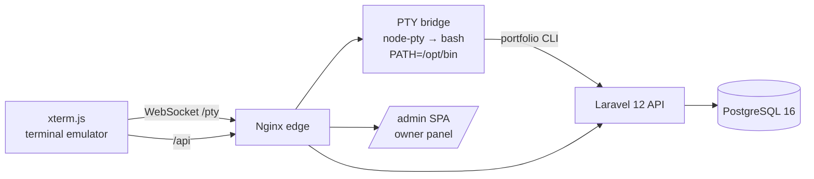

# 🖥️ imam-portfolio — A Real Arch Terminal Portfolio

**A portfolio website that runs inside a real Arch Linux shell.**

Visitors don't scroll through a static page — they land in a **live bash session** running in a hardened Arch Linux container (read-only, non-root, curated PATH) and explore the portfolio by typing commands.

> ⚠️ **Honest design note:** this is a real shell, but a *curated* one — the PATH only exposes
> read-only tools and the filesystem is mounted read-only. It is not a general-purpose
> remote shell for anonymous visitors. See [Security](#-security).

---

## ✨ What it does

| Command | What visitors see |
|---|---|
| `show all` | The entire portfolio at a glance |
| `about` · `experience` · `education` | Professional intro & background |
| `skills` · `certifications` | Technical skills & certificates (with attachments) |
| `projects [show <id>]` | Featured projects with details, screenshots, links |
| `publications` · `socials` | Publications & social links (clickable, Ctrl+Click) |
| `fastfetch` · `pacman -Q` · `uname` | **Real** Arch binaries — real kernel, real package metadata |
| `help` · `clear` | Curated command list · welcome screen |

Everything the owner edits in the **admin panel** (or directly in PostgreSQL) is
reflected in the terminal instantly.

---

## 🚀 Quick start

```bash
cp .env.example .env        # set DB_PASSWORD & ROOT_PASSWORD
docker compose --profile sandbox up -d --build
```

Open **http://localhost:8080** — you're in the shell.

> Backend, frontend and the PTY shell are containerized; no local Node/PHP required.
> Full documentation (env vars, deployment, threat model): **[README.dev.md](README.dev.md)**.

---

## 🏗️ Architecture



- **PTY shell** — real `bash` in an Arch container, running as non-root `visitor`
  with an allowlisted PATH (`ls`, `cat`, `grep`, `pacman`, `fastfetch`, …) and a
  read-only root filesystem.
- **Portfolio commands** — a single compiled Go dispatcher (`pty/portfolio-cli.go`)
  that talks to the Laravel REST API (`/api/v1/*`).
- **Owner panel** — hidden command `config-admin` in the shell → one-time link →
  browser session → full CRUD for profile, projects, skills, experience, education,
  certifications (with file uploads), publications, fetch info & terminal theme.
- **Welcome banner** — logo + info rows rendered as a single canvas image (sixel/
  iTerm2 inline protocol) so it looks identical on load, `clear`, and `Ctrl+L`.

## 🧰 Tech stack

| Layer | Tech |
|---|---|
| Shell | Arch Linux container · bash · node-pty · Go dispatcher |
| Frontend | React · TypeScript · Vite · xterm.js · Tailwind CSS |
| Backend | Laravel 12 · PHP 8.4 · PostgreSQL 16 |
| Infra | Docker Compose · Nginx · FrankenPHP |

## 🔒 Security

- **Read-only by design:** allowlisted PATH, read-only rootfs, no interpreters
  or compilers in the runtime image (multi-stage build), no network egress,
  `cap_drop ALL`, non-root, PID/CPU/memory limits.
- **Sessions:** random tickets, per-IP rate limits, global session cap, idle TTL,
  output limits — the bridge rejects anything without a valid ticket.
- **No general remote shell:** every visitor command resolves to a curated binary
  or the fixed dispatcher; there is no `sh`/`python`/`curl` inside the shell.

**Honest limitations:** Docker is not a perfect isolation boundary — for a public
production deployment consider gVisor/Firecracker or keep the shell feature off.
Details in [README.dev.md](README.dev.md).

---

## 🗂️ Structure

```
frontend/   xterm.js emulator + /admin owner panel
backend/    Laravel 12 REST API (/api/v1)
pty/        Arch shell: PTY bridge + portfolio dispatcher (Go)
nginx/      edge proxy: static, /api, /pty WebSocket
```

---

## 📜 License

Personal portfolio project. Not affiliated with Arch Linux.
